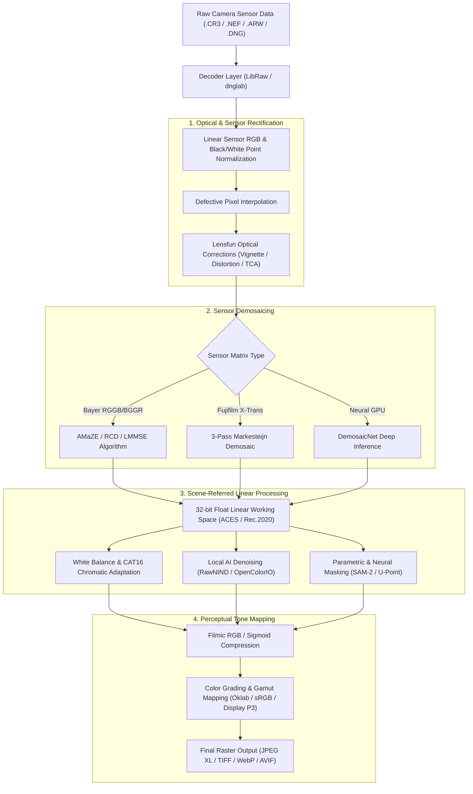

  

  
  
  
  
  
  
  

# 📸 Awesome RAW Photo Processing 🎞️

> **A definitive, community-curated directory of premier commercial SaaS suites and high-performance open-source GitHub projects for RAW photo processing, demosaicing, non-destructive editing, scene-referred color science, GPU-accelerated pipelines, and local on-device AI denoising.**

---

## 📑 Table of Contents
- [🔍 Overview & SEO Highlights](#-overview--seo-highlights)
- [🌐 Sector Overview & Market Dynamics](#-sector-overview--market-dynamics)
- [☁️ SaaS & Commercial RAW Processing Suites](#️-saas--commercial-raw-processing-suites)
- [💻 Open-Source GitHub Projects](#-open-source-github-projects)
- [🔬 In-Depth Open-Source Engine Profiles](#-in-depth-open-source-engine-profiles)
- [🏗️ Architectural Pipeline: From Sensor Bayer to Display](#️-architectural-pipeline-from-sensor-bayer-to-display)
- [🛠️ Tool Selection Matrix](#️-tool-selection-matrix)
- [🤝 How to Contribute](#-how-to-contribute)
- [📈 Star History](#-star-history)
- [💖 Support & Sponsoring](#-support--sponsoring)
- [⚖️ Disclaimer & License](#️-disclaimer--license)

---

## 🔍 Overview & SEO Highlights

**RAW photo processing** is the foundational discipline of digital photography and computational imaging. Unlike pre-baked JPEG or HEIF files compressed inside camera firmware, a camera RAW image preserves unadulterated sensor readings (typically 12-bit, 14-bit, or 16-bit linear sensor voltage values). Converting these uncompressed mosaics into high-fidelity raster images requires specialized pipelines:

- 🔬 **Sensor Demosaicing**: Reconstructing full RGB color at each pixel from Bayer color filter arrays (RGGB, BGGR) or Fujifilm X-Trans patterns using algorithms like **AMaZE**, **RCD**, **LMMSE**, **AHD**, or neural inference (**DemosaicNet**).
- 🌈 **Scene-Referred Color Science**: Processing image light ratios linearly before applying human-perceptual tone curves (**Filmic RGB**, **Sigmoid Tone Mapping**, **ACEScc/ACEScg**, **Oklab**), avoiding clipped highlights, hue shifts, and unnatural skin tones.
- ⚡ **GPU-Accelerated Compute Pipelines**: Harnessing **Vulkan**, **OpenCL**, **Metal**, and **WebGPU** shaders to deliver 60 fps real-time 4K/8K rendering across 100+ megapixel files.
- 🤖 **Local On-Device AI Models**: Deploying neural networks strictly offline via ONNX Runtime and PyTorch for zero-telemetry image enhancements (**SAM-2** subject masking, **RawNIND** sensor noise removal, and **Big-LaMa** content-aware object deletion).
- 🎯 **Lens Geometry & Optical Rectification**: Utilizing open databases like **Lensfun** to rectify vignetting, barrel/pincushion distortion, and transversal chromatic aberration (TCA).

---

## 🌐 Sector Overview & Market Dynamics

The global photo editing and RAW image processing software market is valued at approximately **$1.15 billion to $1.60 billion**, projected to expand beyond **$2.45 billion by 2032** charting a Compound Annual Growth Rate (CAGR) of **6.8% to 7.6%**, driven by professional mirrorless camera sales, high-resolution sensor innovations, and the integration of on-device neural imaging engines.

The sector exhibits **high concentration at the enterprise tier (winner-takes-most dynamics)** paired with **moderate fragmentation across specialized creative niches**:
- **Enterprise & Subscription Dominance**: **Adobe** commands the dominant market position (~55%–65% market share) across commercial creative workflows through its Creative Cloud ecosystem lock-in (Lightroom Classic, Lightroom, and Photoshop).
- **High-End Studio & Optical Specialization**: Commercial and fashion studios gravitate toward **Capture One** for unrivaled studio tethering reliability and ICC color profiling, while optical purists rely on **DxO Labs** for proprietary laboratory lens profiles and DeepPRIME neural demosaicing.
- **The Sovereign Open-Source Movement**: Recurring subscription fatigue, forced cloud synchronization, and telemetry concerns have triggered explosive community adoption of local-first, GPU-accelerated open-source suites like **darktable**, **RapidRAW**, and **RawTherapee**, delivering 100% data sovereignty and 32-bit floating-point precision without recurring fees.

---

## ☁️ SaaS & Commercial RAW Processing Suites

The table below catalogs leading commercial and hosted RAW workflow platforms, **sorted in descending order by company scale (market valuation / annual recurring revenue)**.

| 🏢 Platform | 📊 Company Scale (Revenue / Valuation) | 💵 Pricing (Starting Paid Tier) | 🎁 Free Tier Limit | 🌟 Core Capabilities & Focus |
|:---|:---|:---|:---|:---|
| **[Adobe Lightroom Classic](https://www.adobe.com/products/photoshop-lightroom-classic.html)** | **~$195 Billion Market Cap** (~$21.5B ARR) | **$9.99/month** (Lightroom 1TB Plan) or **$19.99/month** (Photography Plan with Classic, Photoshop & 20GB cloud) | **7-day free trial** with full feature access to desktop and mobile apps, 20GB cloud sync, and camera profiles; requires Adobe ID registration; no permanent free tier | Industry-standard digital asset management (DAM), non-destructive cataloging, AI Denoise, Generative Remove, and multi-device cloud synchronization. |
| **[Capture One Pro](https://www.captureone.com/)** | **~$35M – $50M ARR** (Axcel Private Equity backing) | **$24.00/month** (or **$179.00/year** annual subscription; **$299.00** one-time perpetual license) | **30-day free trial** with unrestricted access to live studio tethering, custom ICC camera profiles, 3-way color wheels, and batch export; no permanent free tier | Studio-grade live tethering, ultra-precise skin tone editor, calibrated color science, speed editing hotkeys, and session/catalog architectures. |
| **[DxO PhotoLab](https://www.dxo.com/dxo-photolab/)** | **~$15M – $25M ARR** (Privately held) | **$139.00 one-time** (Essential Edition) or **$229.00 one-time** (Elite Edition) | **30-day free trial** with 100% full access to DeepPRIME XD2 neural denoising, laboratory-calibrated lens optics corrections, and U-Point local masking without watermarks; no permanent free tier | World-class laboratory lens defect correction (distortion, vignetting, chromatic aberration), DeepPRIME AI demosaicing/denoising, and intuitive U Point local adjustments. |
| **[Skylum Luminar Neo](https://skylum.com/luminar)** | **~$15M – $20M ARR** (Privately held) | **$11.95/month** (or **$79.00/year** annual subscription, or **$199.00** one-time perpetual license) | **7-day free trial** with full access to generative AI tools (Sky AI, Relight AI, GenErase, Face AI) and modular RAW develop engine; no permanent free tier | AI-automated portrait retouching, generative sky replacement, dynamic scene relighting, and modular layer-based RAW processing plugins. |
| **[ON1 Photo RAW](https://www.on1.com/products/photo-raw/)** | **~$8M – $12M ARR** (Privately held) | **$99.99 one-time** perpetual license (or **$7.99/month** / **$89.99/year** ON1 Everything subscription) | **14-day free trial** with complete access to RAW development, NoNoise AI, Super Select AI, Brilliance AI, and photo organizer without watermarks; no permanent free tier | All-in-one RAW photo organizer and processor, NoNoise AI, Super Select AI, keyword tagging, and Photoshop/Lightroom plugin workflow. |
| **[Exposure X7](https://exposure.software/)** | **~$3M – $6M ARR** (Privately held) | **$129.00 one-time** perpetual license (Standard) or **$149.00 one-time** (Bundle) | **30-day free trial** with unrestricted catalog-free RAW photo editing, analog film emulation presets, and creative layering tools; no permanent free tier | Analog film emulsion simulation, creative color toning, non-destructive RAW editing, and catalog-free file organization. |

---

## 💻 Open-Source GitHub Projects

Curated open-source RAW photo editors, demosaicing engines, and imaging libraries, **sorted in descending order by GitHub stargazers count**.

| 📦 Repository | ⭐ GitHub_Stars | 📜 License | 🛠️ Tech Stack | 🎯 Focus Area |
|:---|:---:|:---:|:---|:---|
| **[darktable](https://github.com/darktable-org/darktable)** |  | GPL-3.0 | C, OpenCL, GTK3, Lua | Premier full-featured Lightroom alternative; scene-referred pipeline, filmic RGB, and integrated DAM |
| **[RapidRAW](https://github.com/CyberTimon/RapidRAW)** |  | GPL-3.0 | Rust, WebGPU, Python, PyTorch | Fast GPU-accelerated modern editor with local AI denoising (NIND), SAM-2 masks, and LUT export |
| **[RawTherapee](https://github.com/RawTherapee/RawTherapee)** |  | GPL-3.0 | C++, GTK3, OpenMP | Advanced demosaicing specialist (AMaZE, LMMSE), 32-bit float engine, and multi-scale wavelets |
| **[LibRaw](https://github.com/LibRaw/LibRaw)** |  | LGPL-2.1 | C++, C | Industry-standard foundation library decoding RAW files from 1,000+ camera models |
| **[Lensfun](https://github.com/lensfun/lensfun)** |  | LGPL-3.0 | C++, CMake | Database and algorithmic library rectifying lens vignetting, distortion, and chromatic aberration |
| **[rawpy](https://github.com/letmaik/rawpy)** |  | MIT | Python, Cython, LibRaw | Pythonic wrapper for LibRaw exposing RAW sensor Bayer arrays as NumPy ndarrays |
| **[digiKam](https://github.com/KDE/digikam)** |  | GPL-2.0 | C++, Qt5/Qt6, KDE Frameworks | Professional photo management suite with built-in RAW development, metadata tagging, and face recognition |
| **[Filmulator](https://github.com/CarVac/filmulator-gui)** |  | GPL-3.0 | C++, Qt Quick, QML | Physical film emulsion simulator reproducing dynamic range compression and silver-halide physics |
| **[dnglab](https://github.com/dnglab/dnglab)** |  | LGPL-2.1 | Rust | Blazing-fast CLI camera RAW to open Digital Negative (DNG) converter written in Rust |
| **[vkdt](https://github.com/hanatos/vkdt)** |  | BSD-2-Clause | C, GLSL, Vulkan | Pure Vulkan GPU compute graph photo editor for real-time 8K RAW processing |
| **[ART](https://github.com/artraweditor/ART)** |  | GPL-3.0 | C++, GTK3, OpenMP | Ergonomic RawTherapee derivative balancing deep processing power with an accessible UI |
| **[AlcedoStudio](https://github.com/zidage/AlcedoStudio)** |  | GPL-3.0 | C++, Metal/Vulkan, DuckDB | Node-based GPU RAW editor with Neural DemosaicNet, DuckDB library, and local CLIP AI search |
| **[rawtoaces](https://github.com/AcademySoftwareFoundation/rawtoaces)** |  | BSD-3-Clause | C++, LibRaw, OpenEXR | Academy Color Encoding System (AMPAS) CLI tool converting digital camera RAWs to ACES images |
| **[CalibRaw](https://github.com/Duecki1/CalibRaw)** |  | GPL-3.0 | Rust, Slint UI, ONNX Runtime | Cross-platform GPU RAW editor featuring on-device AI masks (SAM 2.1, BiRefNet) and RawNIND denoise |
| **[Rawstudio](https://github.com/rawstudio/rawstudio)** |  | GPL-2.0 | C, GTK2 | Fast, lightweight RAW photo developer optimized for high-throughput tethered studio shoots |

---

## 🔬 In-Depth Open-Source Engine Profiles

### 1. [darktable](https://github.com/darktable-org/darktable) — The Reference Open-Source Lightroom Alternative
- **Architecture**: Dual-module architecture consisting of **Lighttable** (full digital asset management, IPTC/XMP tagging, filtering, geo-clustering) and **Darkroom** (non-destructive pipeline).
- **Color Science**: Features a modern **scene-referred workflow** (Filmic RGB and Sigmoid tone-mappers) operating in linear camera space to deliver natural highlight reconstruction and roll-off without color clipping.
- **Parametric & Drawn Masks**: Any module can be combined with drawn vector shapes or parametric thresholding based on hue, lightness, and chroma.
- **Lightroom Migration**: Reads Adobe XMP sidecar files, automatically importing ratings, color labels, tags, and basic crop parameters.
- **Honest Caveat**: Substantial learning curve; tool names mirror physical optical phenomena rather than simplified commercial sliders.

### 2. [RapidRAW](https://github.com/CyberTimon/RapidRAW) — Next-Gen GPU Speed & On-Device AI
- **Architecture**: Built from scratch with a Rust core and WebGPU acceleration, eliminating UI latency on ultra-high-resolution files (100MP+).
- **AI Innovations**: Implements **RawNIND** AI neural denoising applied directly onto raw sensor arrays, single-click **SAM-2 (Segment Anything 2)** subject masking, and parametric luminance isolation.
- **Production Export**: Native support for modern container formats including **JPEG XL**, **WebP**, and **3D CUBE LUT** exports for grading synchronization with DaVinci Resolve or Premiere Pro.
- **Honest Caveat**: Rapid release cycle; binaries are not yet code-signed by commercial authorities (requires SmartScreen / Gatekeeper bypass).

### 3. [RawTherapee](https://github.com/RawTherapee/RawTherapee) — The Algorithmic Demosaicing Authority
- **Architecture**: 32-bit floating-point processing engine with multi-threaded OpenMP optimizations.
- **Demosaicing Depth**: Unparalleled array of demosaicing algorithms (AMaZE, IGV, LMMSE, EAHD, VNG4, DCB) with dual-demosaicing for high-detail versus flat-area optimization.
- **Wavelet Processing**: Advanced multi-scale wavelet decomposition for fine texture recovery, chroma noise suppression, and microcontrast enhancement.
- **Honest Caveat**: Focuses strictly on image development; digital asset management, catalog databases, and direct printing pipelines must be handled by external tools like digiKam.

### 4. [Filmulator](https://github.com/CarVac/filmulator-gui) — Physical Film Emulsion Simulation
- **Architecture**: Fluid Qt Quick/QML interface driving an algorithmic simulation of photographic film development chemistry.
- **Algorithmic Principle**: Models light exposing emulsion and developer liquid exhaustion. Large bright regions exhaust local developer fluid (naturally compressing dynamic range), while small bright accents retain local contrast and vivid saturation.
- **Workflow**: Minimalist, distraction-free slider layout purposefully omitting unnecessary technical knobs.
- **Honest Caveat**: Opinionated design; does not support complex local brushes, parametric masks, or geometric lens distortion fixes.

### 5. [ART (Another RawTherapee)](https://github.com/artraweditor/ART) — The Ergonomic Powerhouse
- **Architecture**: Forked from RawTherapee with a redesigned, user-friendly UI and streamlined toolset.
- **Features**: Introduces simplified tone curves, intuitive local contrast modules, automatic perspective correction, and easy Flatpak deployment.
- **Honest Caveat**: Smaller community footprint than parent RawTherapee, though actively maintained by creator Alberto Griggio.

### 6. [AlcedoStudio](https://github.com/zidage/AlcedoStudio) — Node-Based RAW Grading & DuckDB
- **Architecture**: 32-bit float rendering pipeline holding 60 fps at 2.5K preview during active slider adjustments on 150-megapixel medium-format RAWs.
- **Node Graph**: Each image is treated as a directed acyclic graph (DAG) with separate Develop, Color Grade, and Display Transform nodes.
- **DuckDB & CLIP**: Built-in relational DuckDB catalog enabling instant search, paired with local multilingual CLIP embeddings for zero-cloud semantic search (e.g., "sunset over rocky coast").
- **Honest Caveat**: Early-stage project; verify camera lens compatibility profiles before deploying to production studio shoots.

### 7. [CalibRaw](https://github.com/Duecki1/CalibRaw) — Rust-Powered Local AI Studio
- **Architecture**: Written in Rust using the Slint GUI toolkit and ONNX Runtime for multi-platform desktop deployment.
- **Neural Toolset**: Integrates **BiRefNet** for background separation, **SkySeg** for sky masks, **SAM 2.1** for object segmentation, and **Big-LaMa** for zero-grain-loss object erasure.
- **Honest Caveat**: Maturing project; lens correction depends on external Lensfun definitions.

---

## 🏗️ Architectural Pipeline: From Sensor Bayer to Display

---

## 🛠️ Tool Selection Matrix

| Criterion / Use Case | Recommended Solution | Rationale |
|:---|:---|:---|
| **Best Overall Lightroom Replacement** | **darktable** | Complete catalog DAM + scene-referred linear color science + drawn/parametric masks. |
| **Fastest GPU Speed & Modern AI Masks** | **RapidRAW** | WebGPU pipeline, instant 60fps responsiveness, SAM-2 subject masks, and RawNIND denoising. |
| **Deepest Demosaicing & Scientific Control** | **RawTherapee** | 6+ demosaicing algorithms, 32-bit float math, and Wavelet multi-scale texture editing. |
| **High-Volume Studio & Live Tethering** | **Capture One Pro** | Unequaled camera tethering stability, instant live preview, and calibrated studio skin tones. |
| **Best Lens Defect Correction & High-ISO Denoise** | **DxO PhotoLab** | Laboratory-bench optical profiles + proprietary DeepPRIME XD2 neural demosaicing. |
| **Film Simulation with Minimal Sliders** | **Filmulator** | Physically modeled silver-halide developer emulsion physics without slider fatigue. |
| **Pythonic AI Vision & Custom Pipelines** | **rawpy + LibRaw** | Direct NumPy ndarray access to RAW mosaics for custom machine learning training. |

---

## 🤝 How to Contribute

Contributions are warmly welcomed to keep this open directory comprehensive and up-to-date!

1. 🍴 **Fork the repository** on GitHub.
2. 🌿 **Create a descriptive feature branch** (`git checkout -b add-awesome-raw-tool`).
3. 📝 **Add or update entries** following existing markdown guidelines:
   - Provide concrete pricing numbers for SaaS products (no generic terms like 'Custom').
   - Specify concrete free trial days or free tier limits (no 'N/A' or 'None').
   - For open-source projects, ensure social star badges link directly to the repository's `stargazers` page.
4. 🚀 **Submit a Pull Request** with a brief summary of your additions.

---

## 📈 Star History

<!-- star-history.derappage/svg?repos=ishandutta2007/Awesome-Raw-Photo-Processing&type=date&legend=top-left -->

---

## 💖 Support & Sponsoring

If you find this curated directory of RAW photo processing software, open-source algorithms, and commercial suites valuable for your creative projects, please consider showing your support:

- ⭐ **Star this repository** to help other photographers and developers discover it
- 🍴 **Fork and share** with photography clubs, developers, and digital imaging communities
- ☕ **Sponsor the Maintainer**: Buy a coffee or become a recurring backer via the [GitHub Sponsors Dashboard](https://github.com/sponsors/ishandutta2007)

Thank you for championing open, local-first, and high-fidelity imaging tools! 🌟

---

## ⚖️ Disclaimer & License

- **Disclaimer**: This repository is a community-curated directory. Brand names, logos, and trademarks belong to their respective copyright holders. Pricing, tier limits, and company scales reflect public records and are subject to change by vendors.
- **Curated Network**: Part of the curated list ecosystem at [Awesome-Awesome-Awesome](https://github.com/ishandutta2007/Awesome-Awesome-Awesome).
- **License**: Released under the [MIT License](LICENSE).
